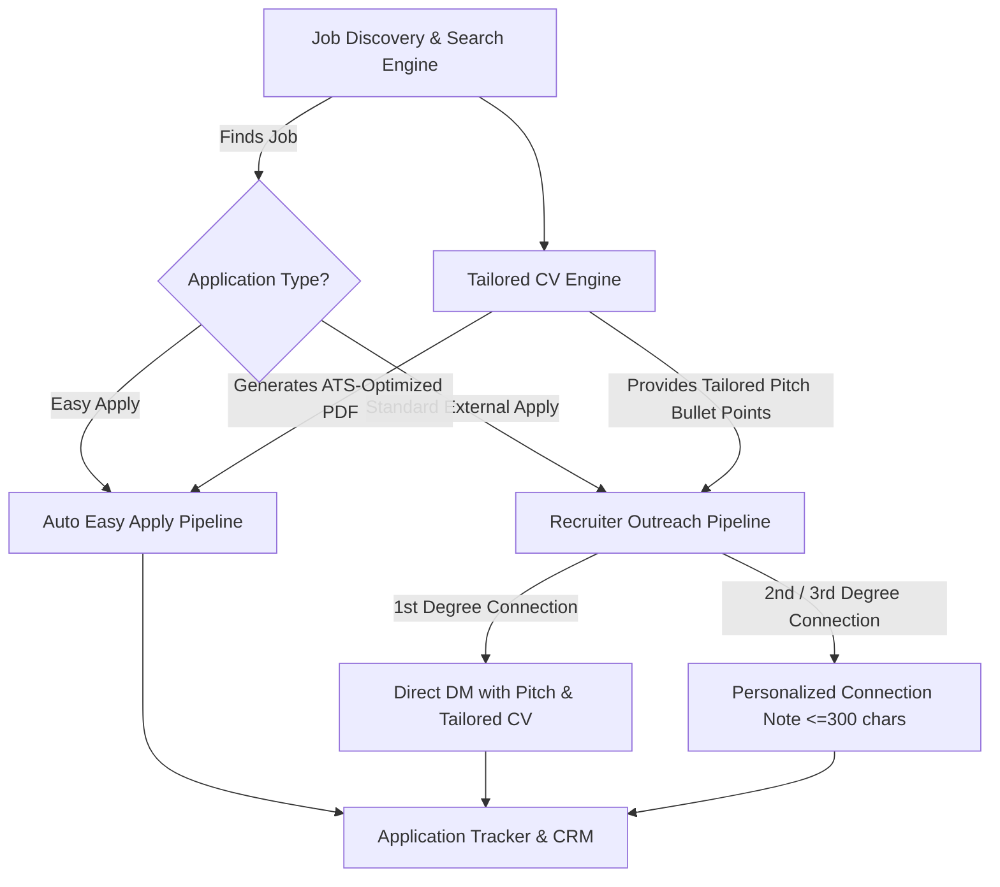

# 🚀 Job Hunter & LinkedIn Automation: Architecture & Feature Roadmap

A comprehensive roadmap and specification for next-generation automated job discovery, tailored CV generation, LinkedIn Easy Apply automation, and smart recruiter outreach.

---

## 📌 High-Level Architecture Overview



---

## 🛠️ Feature Specifications & Tool Designs

### 1. 📄 Dynamic Tailored CV Generator (`generate_tailored_cv`)
**Objective**: Dynamically adapt a candidate's base CV according to the target Job Description (JD) without altering core facts.

- **Inputs**:
  - `user_id`: Candidate identifier (e.g., `shubham`, `akshita358`, `shraddha`).
  - `job_id_or_url`: LinkedIn job posting URL or ID.
  - `custom_jd_text` (optional): Raw JD text if not hosted on LinkedIn.
- **Workflow**:
  1. Extract key technologies, seniority level, domain requirements, and ATS keywords from the target JD.
  2. Parse candidate's existing source profile/JSON in `cv-content/{user_id}/`.
  3. Intelligently refine:
     - **Professional Summary**: Emphasize JD-specific strengths (e.g., Banking/POS, Playwright over Selenium, Cloud/CI-CD).
     - **Skill Ordering**: Promote high-priority JD skills to the top of skill sections.
     - **Experience Highlights**: Highlight accomplishments relevant to the hiring team's tech stack.
  4. Compile using local HTML template (`cv-template/`) and generate an ATS-friendly PDF via `generate-pdf.js` into `temp-pdfs/`.
- **Output**: Path to generated tailored PDF (e.g., `temp-pdfs/Shraddha_Potkar_Qualys_Lead_QA.pdf`).

---

### 2. ⚡ LinkedIn Easy Apply Automation Tool (`apply_easy_apply_job`)
**Objective**: Fully automate the multi-step Easy Apply workflow directly through Playwright.

- **Inputs**:
  - `job_id_or_url`: Target LinkedIn job posting with Easy Apply.
  - `tailored_cv_path`: Path to the tailored PDF resume.
  - `screening_profile`: JSON config containing standard answers (years of experience, citizenship, notice period, expected CTC, sponsorship needs).
- **Workflow**:
  1. Open job posting and click the `Easy Apply` button.
  2. Detect multi-step modal dialogs:
     - **Contact Information**: Auto-verify phone number and email.
     - **Resume Upload**: Attach tailored CV PDF.
     - **Screening Questions**: Auto-fill numeric (e.g., *Years of Java? -> 8*), dropdowns, and checkboxes using the pre-configured screening profile.
     - **Review Step**: Verify all fields are valid.
  3. Provide a safety flag (`dry_run=True` by default to review answers before final submit).
- **Output**: Application confirmation ID, screenshot, and status record.

---

### 3. 🎯 Active Recruiter Outreach Engine (`outreach_recruiter_for_job`)
**Objective**: If a job is not Easy Apply (or for proactive high-touch applications), immediately find and engage the verified active recruiter at that company.

- **Inputs**:
  - `job_id_or_url`: Target job URL.
  - `company_name`: Target company.
  - `user_id`: Candidate identifier.
- **Workflow**:
  1. Use the verified recruiter locator to find the primary talent partner currently working at the company.
  2. Check connection status:
     - **1st Degree (Already Connected)**:
       - Send a direct message in card style via fast `send_dm`.
       - Message includes: Brief 3-sentence tailored pitch, alignment with the open role, and portfolio/CV reference.
     - **2nd / 3rd Degree (Not Connected)**:
       - Send a customized connection request note ($\le 300$ characters):
         > *"Hi [Name], I noticed the [Role Title] opening at [Company]. With 8+ yrs leading QA frameworks (Playwright/Java) & banking systems, I’d love to connect and share my CV. Thanks, [Candidate]"*
  3. Log the recruiter interaction to prevent duplicate contacts within 30 days.

---

### 4. 📊 Unified Application Pipeline & CRM (`track_application`)
**Objective**: Centralized status tracking across all searched, applied, and contacted roles.

- **Database / Schema** (`tasks/pipeline.json` or SQLite):
  ```json
  {
    "job_id": "4478109623",
    "company": "Qualys",
    "title": "Lead QA Engineer",
    "location": "Pune",
    "applied_type": "Easy Apply | Recruiter Outreach | External",
    "status": "Contacted | Applied | In Review | Interview",
    "recruiter": {
      "name": "Kajal Navale",
      "profile_url": "https://www.linkedin.com/in/kajal-navale-294738172/",
      "outreach_date": "2026-10-20",
      "outreach_type": "DM | Connection Note"
    },
    "tailored_cv_path": "temp-pdfs/Shraddha_Potkar_Qualys.pdf",
    "notes": "Follow-up scheduled in 5 days"
  }
  ```
- **Capabilities**:
  - `list_applications(status="Applied")`
  - `get_pending_followups()`
  - Anti-duplicate filter to guarantee a company is never spammed twice.

---

### 5. 🤖 AI Job Match & Fit Scorer (`score_job_fit`)
**Objective**: Quick heuristic scoring before applying to maximize interview conversion.

- **Features**:
  - **Match Score (0–100%)**: Based on core tech stack, seniority, domain, and location.
  - **Green Flags**: Exact matching frameworks (e.g., Playwright, Core Java, TestNG).
  - **Red Flags / Missing Requirements**: Required tools not in CV (e.g., Python, Cypress, AWS).
  - **Recommended Action**: `Apply Immediately`, `Apply with Tailored CV`, or `Skip`.

---

### 6. 🛡️ Safety, Stealth & Account Protection Guardrails
- **Smart Throttling**: Random jitter delays (2.5s – 6.0s) between actions.
- **Daily Budget Caps**:
  - Maximum 15–20 connection requests/day.
  - Maximum 25 DMs/day.
  - Maximum 30 Easy Apply submissions/day.
- **User Approval Mode**:
  - Mutation protection (`confirmed=False` prompts for user approval before submitting applications or sending connection requests).

---

## 📋 Implementation Milestones

- [x] **Milestone 1**: Fast direct messaging engine (sub-2s delivery via `insert_text`).
- [x] **Milestone 2**: Strict verified recruiter card extraction (eliminates mutual connection bugs).
- [ ] **Milestone 3**: Tailored CV builder CLI (`generate_tailored_cv`) linking `cv-content/` with target JD keywords.
- [ ] **Milestone 4**: Automated Easy Apply module with screening question answering.
- [ ] **Milestone 5**: Recruiter connection note dispatcher (`connect_with_note`).
- [ ] **Milestone 6**: Persistent Pipeline Tracker (`pipeline.json`).
